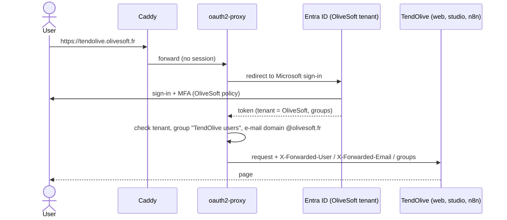

# Deployment on Azure

How TendOlive would run for OliveSoft in production. OliveSoft works on Azure and has no server of its own, so the
target is the **cheapest Azure setup that runs the system reliably**: one Linux virtual machine running the existing
`docker compose` stack, behind HTTPS and OliveSoft's Microsoft sign-in. It is a plan: it has not been deployed yet, and
the cost figures are estimates to check in the [Azure Pricing Calculator](https://azure.microsoft.com/pricing/calculator/).

## 1. Requirements that drive the choice

| Need | Consequence |
|---|---|
| A small bid team, one main pipeline run a week, decks on demand | one machine is enough; no need for clusters or autoscaling |
| RAG with ML models (E5 embeddings + cross-encoder, ~3 GB RAM), Chromium for exports and diagrams | a VM with 16 GB RAM rather than small serverless containers |
| n8n must be up for its weekly schedule and webhooks; its database is SQLite on a volume | a persistent machine with a local disk, not scale-to-zero containers |
| CVs are personal data | data in the EU (France Central), access limited to OliveSoft staff, encrypted backups |
| OliveSoft uses Microsoft 365 | sign-in with their existing Entra ID accounts; the Teams bot already uses the same tenant |
| Lowest cost and risk | reuse exactly what is tested today (`docker compose`), no rewrite |

## 2. Architecture

```mermaid
flowchart LR
    subgraph Users
        B[Browser<br/>bid team]
        T[Microsoft Teams]
    end
    subgraph Microsoft365[OliveSoft Microsoft 365 tenant]
        E[Entra ID<br/>single-tenant app<br/>group 'TendOlive users']
        AB[Azure Bot<br/>F0 free tier]
    end
    subgraph Azure[Azure subscription · France Central · resource group rg-tendolive]
        subgraph VM[Linux VM · B4as_v2 · 4 vCPU / 16 GB · Ubuntu 24.04]
            C[Caddy<br/>HTTPS 443, certificates]
            O[oauth2-proxy<br/>Entra sign-in, OliveSoft only]
            W[web<br/>React app]
            S[proposal-studio<br/>decks, exports, Mermaid]
            N[n8n<br/>pipeline, deck agents, chat]
            R[rag<br/>matching, knowledge base]
            TB[teams-bot]
            D[(Volumes on Premium SSD<br/>n8n, decks, tenders, templates)]
        end
        KV[Key Vault<br/>API keys, secrets]
        BL[(Blob Storage · cool tier<br/>nightly backups, 30 days)]
        MON[Azure Monitor<br/>availability test, alerts]
    end
    LLM{{LLM provider<br/>Groq / Gemini / OpenAI}}
    SRC{{Tender sources<br/>BOAMP, TED, portals}}

    B -->|tendolive.olivesoft.fr| C --> O
    O -. sign-in .-> E
    O --> W & S & N
    W --> R
    N --> R & S
    T --> AB -->|bot.tendolive.olivesoft.fr| C --> TB
    TB --> N
    N --> LLM & SRC
    S --> D
    N --> D
    R --> D
    VM -. secrets at deploy .-> KV
    VM -. ops/backup.sh nightly .-> BL
    MON -. HTTPS checks .-> C
```

Only Caddy listens on the internet (443). Every container port stays bound to 127.0.0.1 on the VM, as in
`docker-compose.yml` today; the RAG is never exposed.

## 3. Sign-in: OliveSoft staff only



1. **Single-tenant app registration** in OliveSoft's Entra ID: only accounts of the OliveSoft tenant can sign in;
   outsiders, guests and personal Microsoft accounts are refused by Microsoft itself.
2. **"Assignment required = Yes"** with the group *TendOlive users*: only the people IT adds get in.
3. **Roles from groups**: *Viewer* (read), *Bid team* (bid / no-bid, export), *Admin* (pricing, knowledge base, n8n).
4. **MFA and conditional access** come from OliveSoft's Microsoft 365 policy.
5. **`@olivesoft.fr` e-mail domain** checked by oauth2-proxy (`--email-domain=olivesoft.fr`) as a second line, not as
   the main control (an e-mail address alone can be a guest's).

The apps then read the signed-in user from the headers oauth2-proxy adds: enough for roles and an audit trail. This
needs the code changes listed in [README.md](README.md#what-must-change-in-the-code-before-production) (items 1 and 4).

## 4. Azure services and why

| Service | Use | Why this one | Alternatives not chosen |
|---|---|---|---|
| **Virtual Machine** (B4as_v2: 4 vCPU, 16 GB, Ubuntu 24.04) | runs the whole `docker compose` stack | cheapest for an always-on stack with 3 GB of models; burstable B-series fits a mostly idle workload | Container Apps (fragile for n8n's SQLite, slow RAG cold start), AKS (far too much to run), App Service (awkward for 6 containers with volumes) |
| **Premium SSD** 64 GB | Docker images, volumes, indexes | fast index builds, snapshots | Standard HDD (slow) |
| **Public IP** (static) + DNS record | `tendolive.olivesoft.fr`, `bot.tendolive.olivesoft.fr` | Caddy needs a stable address for certificates | — |
| **Entra ID** app registration | sign-in, groups, roles | OliveSoft already has it; free | own user database (to build and secure) |
| **Key Vault** | API keys, client secrets | secrets out of files and chats, access logged, rotation | `.env` only |
| **Blob Storage** (cool tier, lifecycle 30 days) | nightly backups from `ops/backup.sh` | cheap, encrypted at rest, versioning | Azure Backup for VMs (fine too, costs more per GB) |
| **Azure Monitor** | availability test on the site, CPU / disk alerts, e-mail to IT | built in | external uptime service |
| **Azure Bot** (F0) | Teams channel of the bot | free for Teams | — |
| **Network Security Group** | allow 443 (and 22 from IT's IP only) | everything else closed | — |

## 5. Estimated monthly cost (France Central, Nov 2026)

| Item | Running 24/7 | Auto-shutdown (weekdays 07:00–20:00) | 1-year reservation, 24/7 |
|---|---|---|---|
| VM B4as_v2 | ~€110–140 | ~€45–60 | ~€70–85 |
| Premium SSD 64 GB | ~€10 | ~€10 | ~€10 |
| Static public IP | ~€3 | ~€3 | ~€3 |
| Blob Storage backups (~2 GB × 30) | ~€1–2 | ~€1–2 | ~€1–2 |
| Key Vault, Monitor, Azure Bot F0, Entra ID | ~€0–5 | ~€0–5 | ~€0–5 |
| **Infrastructure total** | **~€125–160** | **~€60–80** | **~€85–105** |

On top: **LLM usage**, paid to the provider. It depends on the number of tenders analysed and decks generated, and is
often larger than the infrastructure; use a paid tier (free tiers rate-limit the market studies) and set a spending
limit on the provider account. With auto-shutdown, schedule the weekly pipeline run inside the working hours.

## 6. Walkthrough: from an empty subscription to a running system

Done by OliveSoft IT (Azure access) with the TendOlive team. Names are examples.

**Step 1: resource group, network, VM** (Azure CLI)

```bash
az group create -n rg-tendolive -l francecentral
az vm create -g rg-tendolive -n vm-tendolive --image Ubuntu2404 --size Standard_B4as_v2 \
  --os-disk-size-gb 64 --storage-sku Premium_LRS --public-ip-sku Standard \
  --admin-username tendolive --ssh-key-values ~/.ssh/id_ed25519.pub
az vm open-port -g rg-tendolive -n vm-tendolive --port 443 --priority 100
az vm auto-shutdown -g rg-tendolive -n vm-tendolive --time 1900      # optional, UTC; start it at 06:00 with an Automation runbook
```

Restrict SSH (22) to IT's address in the Network Security Group.

**Step 2: DNS.** Point `tendolive.olivesoft.fr` and `bot.tendolive.olivesoft.fr` to the VM's public IP (A records).

**Step 3: Entra ID app registration** (portal, Entra ID > App registrations)
- New registration, *Accounts in this organizational directory only*, redirect URI
  `https://tendolive.olivesoft.fr/oauth2/callback`.
- Client secret (store it in Key Vault), API permission *User.Read*, token configuration: add the *groups* claim.
- Enterprise applications > the app > Properties: *Assignment required = Yes*; Users and groups: add *TendOlive users*.
- Create the groups *TendOlive bid team* and *TendOlive admins* for the roles.

**Step 4: Key Vault**

```bash
az keyvault create -g rg-tendolive -n kv-tendolive -l francecentral
az keyvault secret set --vault-name kv-tendolive -n GROQ-API-KEY --value "<key>"
# ... one secret per key of .env (STUDIO_API_KEY, AGENTS_WEBHOOK_KEY, BOT_* , OAUTH2 client secret, ...)
```

Give the VM a managed identity with *Key Vault Secrets User*, and write `.env` from the vault at deploy time.

**Step 5: install and start TendOlive** (on the VM)

```bash
curl -fsSL https://get.docker.com | sh && sudo usermod -aG docker tendolive
git clone git@github.com:adeilm/rfp.git /opt/TendOlive && cd /opt/TendOlive
cp .env.example .env && chmod 600 .env        # then fill it from Key Vault (section 7)
docker compose -f docker-compose.yml -f docker-compose.prod.yml up -d --build
docker compose ps                             # wait until every service is healthy (first build 10-30 min)
```

**Step 6: HTTPS and sign-in.** Install Caddy and oauth2-proxy (section 8). Open `https://tendolive.olivesoft.fr`:
Microsoft sign-in, then the app.

**Step 7: first configuration.** Create the n8n owner account; enter OliveSoft's real day rates on the Pricing page;
check the knowledge base; register the Teams app ([../teams-bot.md](../teams-bot.md) §3) with
`https://bot.tendolive.olivesoft.fr/api/messages`.

**Step 8: backups, retention, monitoring**
- Crontab: `ops/backup.sh` nightly, then upload to Blob Storage (`az storage blob upload-batch`), lifecycle rule 30 days.
- Crontab: `ops/retention.sh` weekly ([../retention-policy.md](../retention-policy.md)).
- Azure Monitor: availability test on `https://tendolive.olivesoft.fr`, alerts on CPU > 90 % and disk > 80 %.
- Test a restore on a spare VM ([operations.md](operations.md)).

## 7. Production settings (`.env`)

| Setting | Production value |
|---|---|
| `STUDIO_API_KEY`, `AGENTS_WEBHOOK_KEY`, `BOT_NOTIFY_KEY` | three different random strings (`openssl rand -hex 32`), from Key Vault |
| `LLM_PROVIDER`, `DECK_LLM_PROVIDER`, `CHAT_LLM_PROVIDER` | paid tiers; one provider for Main and another for the decks spreads the quota |
| `PIPELINE_DEMO_MODE` | `false`; `PIPELINE_RESEARCH_DEMO_BUYERS` empty; `demo-tenders` not started |
| `PIPELINE_PRESET` | `production` |
| `FIRECRAWL_KEY` | set, to read the tender portals |
| `TEAMS_WEB_APP_URL` | `https://tendolive.olivesoft.fr` |
| `TEAMS_ALLOWED_USERS`, `TEAMS_APPROVER_USERS` | the bid team's Entra object ids |
| `BOT_TEST_MODE` | `0` |
| `RFP_FORCE_IMPORT` | `0`, except for the start that installs a new version of the workflows |

The `localhost` addresses written in `docker-compose.yml` must be replaced by the public ones. Until they are `.env`
variables (roadmap item 3), use an override file:

```yaml
# docker-compose.prod.yml: docker compose -f docker-compose.yml -f docker-compose.prod.yml up -d
services:
  web:
    build:
      args:
        VITE_STUDIO_URL: https://tendolive.olivesoft.fr/studio
        VITE_N8N_URL: https://tendolive.olivesoft.fr/n8n
  rag:
    environment:
      RAG_CORS_ORIGINS: https://tendolive.olivesoft.fr
  proposal-studio:
    environment:
      PUBLIC_EDITOR_URL: https://tendolive.olivesoft.fr/studio
  n8n:
    environment:
      N8N_EDITOR_BASE_URL: https://tendolive.olivesoft.fr/n8n
      WEBHOOK_URL: https://tendolive.olivesoft.fr/n8n/
      N8N_PROTOCOL: https
  demo-tenders:
    profiles: ["demo"]        # not started in production
```

Path prefixes (`/studio`, `/n8n`) need the matching base paths in those services; separate host names
(`studio.`, `n8n.`) avoid that and are simpler. Check every key against the `docker-compose.yml` of the deployed version.

## 8. Reverse proxy and sign-in (example)

```caddyfile
tendolive.olivesoft.fr {
    reverse_proxy 127.0.0.1:4180          # oauth2-proxy, which forwards signed-in requests to web :5173
}
bot.tendolive.olivesoft.fr {
    reverse_proxy 127.0.0.1:3978          # Teams bot: authenticated by the Bot Framework itself, not by oauth2-proxy
}
```

```bash
oauth2-proxy --provider=entra-id \
  --oidc-issuer-url=https://login.microsoftonline.com/<tenant-id>/v2.0 \
  --client-id=<app-id> --client-secret=<from Key Vault> --cookie-secret=<random 32 bytes> \
  --email-domain=olivesoft.fr --allowed-group=<TendOlive users group id> \
  --upstream=http://127.0.0.1:5173 --http-address=127.0.0.1:4180 \
  --redirect-url=https://tendolive.olivesoft.fr/oauth2/callback --pass-user-headers=true
```

## 9. Upgrades and rollback

```bash
cd /opt/TendOlive
ops/backup.sh                     # always back up first
git pull --ff-only origin main
docker compose -f docker-compose.yml -f docker-compose.prod.yml up -d --build
docker compose ps
```

- A release that changes the n8n workflows: start once with `RFP_FORCE_IMPORT=1` (it replaces edits made in the n8n
  editor), then back to `0`.
- A release that changes the RAG rules: the index is rebuilt automatically at start (a few minutes).
- Rollback: `git checkout <previous tag>`, rebuild, and `ops/restore.sh` the backup taken before the upgrade if data changed.
- Tag every deployed release (`git tag v1.x.y && git push --tags`).

## 10. Version 2, if usage grows

| Change | Gain | Cost / effort |
|---|---|---|
| n8n on **Azure Database for PostgreSQL** (Flexible, B1ms) | n8n state off the VM, point-in-time restore | ~€15–25 / month, a migration of n8n's data |
| Services on **Azure Container Apps**, RAG with 1 minimum replica | managed scaling, built-in Entra sign-in (Easy Auth), no VM to patch | config per service, persistent storage on Azure Files, more moving parts |
| **Azure Front Door** + WAF | global HTTPS, web application firewall | ~€35+ / month |
| A local or Azure OpenAI model in the same region | tender and CV data stay in Azure | GPU cost (local) or Azure OpenAI quota |
