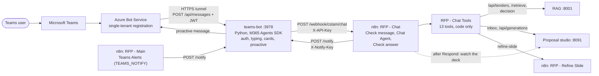
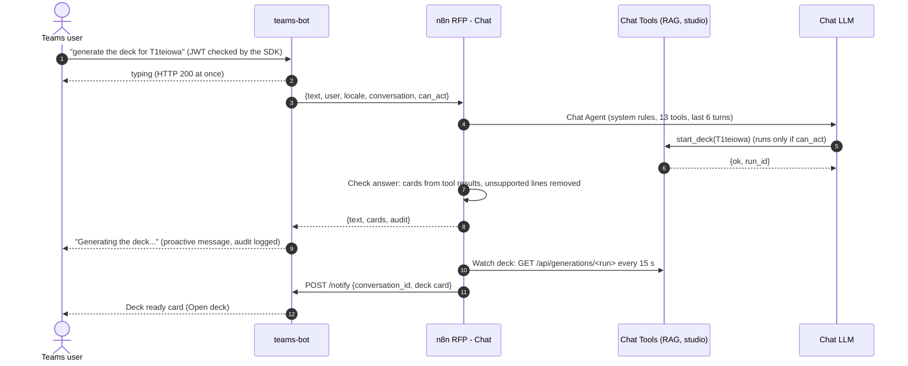

# Microsoft Teams bot

TendOlive answers in Microsoft Teams (1:1 chats, group chats and channels) from the same facts as the web app, and lets
approvers act on decks without leaving Teams:

- **Ask:** "top tenders", "which tenders fit this week", "details of T1teiowa", "requirements matrix of T1teiowa", "do we
  cover Power BI and 2 data engineers", "who has a PMP", "what are the gaps of T1teiowa", "who is the buyer", "budget range".
- **Act** (approvers): "generate the deck for T1teiowa", "status", "refine slide 5 of deck 91002df3: make it shorter",
  "export T1teiowa" (a link: export happens in the editor after price approval), No-bid with a reason.
- **Be notified:** after a run of RFP - Main, one card per high or medium fit tender in the alert channel, with the buttons
  Open tender | Generate deck | No-bid; a deck started from Teams is posted in the same conversation when it is ready.
- **Language:** English or French, from the words of the message (the Teams locale on a tie).

The design rule of the project holds here too: **agents decide, code states facts.** The chat agent chooses which tools to
call; the cards are built by code from the tools' results; a line of the agent's text that names a tender id, a knowledge-base
document or a number no tool returned is removed before it reaches Teams; prices are never written in chat.

## 1. Architecture





**Why this split.** The bot container is a thin adapter: Teams authentication, the typing indicator, card layout,
conversation references and proactive sending. Everything that knows about tenders lives in n8n, next to the pipeline, built
from plain JS like the other workflows (`n8n/src/chat/`, `n8n/build.js`) and imported by `n8n/init/init.js` at every start.

**Two routes, decided by code** (`Check message`): a card button or a fixed command (`help`, `tenders`, `status`) runs ONE
tool with no model (fast, free, works with any LLM); any other message goes to the Chat Agent. The bot answers its own
commands itself: `whoami` (your Entra object id), `alerts here` / `alerts off` (approvers).

**The answer is posted, not returned.** Teams expects the HTTP answer within seconds and an agent turn can take longer:
the bot answers 200 at once, shows "typing", then posts n8n's reply as a proactive message in the same conversation.

## 2. SDK choice (checked 2026-10-31)

| Option | Status | Choice |
|---|---|---|
| Bot Framework SDK (`botbuilder-*`) | Retired: support ended 2025-12-31, repositories archived 2026-01-05 | no |
| **Microsoft 365 Agents SDK for Python** (`microsoft-agents-*` 1.9.0, 2026-10-19) | Microsoft's successor of the Bot Framework SDK, stable 1.x | **yes** |
| Teams SDK for Python (`microsoft-teams-apps` 2.1.1) | GA since 2026-05-01; for bots that use most Teams-native features | no: this bot needs messages, cards, buttons and proactive messages only, which the Agents SDK covers ("sufficient" per Microsoft's guide) |

Python because the repository's services are Python and the SDK's aiohttp host fits a small service. The packages are
pinned (`services/teams-bot/requirements.txt`). The bot uses: `CloudAdapter` + `jwt_authorization_decorator` (inbound JWT:
audience = the bot's app id, issuer bound to the tenant), `MsalConnectionManager` (outbound token, authority
`login.microsoftonline.com/<tenant>`), `continue_conversation` (proactive), `CardFactory` / `MessageFactory`. Creating new
**multi-tenant** Azure Bots has been deprecated since 2025-07-31: the bot is **single-tenant**.

## 3. Set it up (about 30 minutes)

You need: a Microsoft 365 tenant where custom apps may be uploaded (your organisation's, or the free Microsoft 365 Developer
Program sandbox), an Azure subscription in the same tenant, and this system running (`docker compose up -d`).

**1. Allow custom apps** (Teams admin, once): Teams admin center > Teams apps > Setup policies > Global > *Upload custom
apps* = On (and Teams apps > Manage apps > Org-wide app settings: custom apps allowed). It can take a few hours to apply.

**2. Register the bot in Azure.**
1. Azure portal > Create a resource > **Azure Bot**. Bot handle: `tendolive-<yours>`; pricing tier **F0** (free);
   Type of App: **Single Tenant**; Creation type: *Create new Microsoft App ID*.
2. When it is created: the bot > Configuration. Copy the **Microsoft App ID** and the **App Tenant ID**.
3. Configuration > *Manage Password* (opens the app registration) > Certificates & secrets > New client secret. Copy its
   **Value** right away (it is shown once; not the Secret ID).
4. The bot > Channels > **Microsoft Teams** > accept the terms > Apply.

**3. Fill `.env`** (never commit it):

```
BOT_APP_ID=<Microsoft App ID>
BOT_APP_PASSWORD=<client secret value>
BOT_TENANT_ID=<App Tenant ID>
BOT_NOTIFY_KEY=<a random string: openssl rand -hex 24>
BOT_TEST_MODE=0
```

Optional: `TEAMS_APPROVER_USERS` (who may run actions; see step 7), `TEAMS_NOTIFY=true` (alerts after RFP - Main),
`CHAT_LLM_PROVIDER` / `CHAT_LLM_MODEL` (section 7).

**4. Start a tunnel** to the bot's port (the bot listens on `127.0.0.1:3978` only). Any HTTPS tunnel works, for example:

```
ngrok http 3978
cloudflared tunnel --url http://localhost:3978
```

Copy the `https://...` address it prints. In Azure: the bot > Configuration > **Messaging endpoint** =
`https://<tunnel host>/api/messages` > Apply. A free tunnel gets a new address at each start: update the endpoint then
(or reserve a fixed domain). Microsoft's quickstart lists Dev Tunnels among the tools that do not support single-tenant bots
for local debugging; ngrok or cloudflared forward the request as it is (UNVERIFIED in a real tenant: see section 10).

**5. Restart the bot and n8n** so they read `.env`:

```
docker compose up -d --force-recreate teams-bot n8n
docker compose logs teams-bot
```

The log must say `Teams: configured`. `http://localhost:3978/health` answers `"teams": true`.

**6. Build and upload the Teams app package:**

```
python services/teams-bot/appPackage/make_package.py
```

It writes `services/teams-bot/appPackage/build/tendolive-teams.zip` (the manifest with your app id and the two icons). Teams >
Apps > Manage your apps > **Upload an app** > Upload a custom app > the zip > Add. For a channel: Add to a team.

**7. Test in this order.**
1. 1:1 chat with TendOlive: `help`, then `top tenders` (a card list), then press *Details* on a tender.
2. `whoami` gives your Entra object id. To restrict actions, put the approvers' ids in `TEAMS_APPROVER_USERS` (comma
   separated) and recreate the bot (step 5).
3. In a channel: `@TendOlive top tenders`, then `@TendOlive alerts here` (approver): new fit tenders will be posted there.
4. Proactive alert: set `TEAMS_NOTIFY=true`, recreate n8n, run RFP - Main in n8n: one card per fit tender (at most 5).

## 4. Using it

| You type / press | What happens | Model? |
|---|---|---|
| `help` / `aide` | the command list, and whether you may run actions | no |
| `tenders`, `top tenders` | the 5 best open tenders by RAG fit (card list with Details / Matrix / Open) | no |
| `status` / `statut` | the latest deck run | no |
| *Details*, *Matrix* buttons | the tender card, the requirements matrix card (8 rows; the app has the rest) | no |
| *Generate deck* button | starts the deck (approvers); the bot posts it when ready | no |
| *No-bid* button | asks for the reason in the card, then records it (approvers) | no |
| `whoami`, `alerts here`, `alerts off` | answered by the bot itself | no |
| any question | the Chat Agent picks tools, code checks the answer | yes |

Demo tenders are always labelled "(demo)". The cards' *Open* buttons go to `TEAMS_WEB_APP_URL` (default
`http://localhost:5173`: it opens only on the machine that runs the system; set the address your colleagues can reach).

## 5. Contracts

### 5.1 Bot -> n8n: `POST /webhook/cstam/chat` (workflow RFP - Chat)

Header `X-API-Key` = `AGENTS_WEBHOOK_KEY` (n8n credential "ChatWebhook", created from `.env` at every start). Body:

```json
{ "text": "details of T1teiowa", "action": null,
  "user": { "id": "<Entra object id>", "name": "Sam Doe" }, "locale": "en-US",
  "conversation": { "id": "19:...@thread.tacv2", "type": "channel" }, "can_act": true }
```

`action` (a card button instead of text): `{"name": "generate_deck" | "no_bid" | "tender" | "matrix" | "deck_status",
"tender_id": "...", "reason": "..."}`. `can_act` is the bot's decision (`TEAMS_APPROVER_USERS`); the key proves the bot sent it.

Answer, always HTTP 200 (`Respond`):

```json
{ "text": "T1teiowa fits ...", "language": "en",
  "cards": [{ "type": "tender_list" | "tender" | "matrix" | "coverage" | "deck", "data": { "...": "facts from the tools" } }],
  "audit": [{ "action": "start_deck", "tender_id": "T1teiowa", "run_id": "0a1b2c3d4e5f" }], "busy": false }
```

`busy: true` = the chat model hit its rate limit: the bot says "busy, retrying in 30 seconds", waits and asks once more
(a button is never retried by itself). Card data shapes: `chatCards` in `n8n/src/lib.js`; layout:
`services/teams-bot/bot/cards.py`.

### 5.2 n8n -> bot: `POST http://teams-bot:3978/notify`

Header `X-Notify-Key` = `BOT_NOTIFY_KEY` (n8n credential "Teams bot notify key"). Body:

```json
{ "conversation_id": "a:1x...", "kind": "deck" | "alert", "text": "The deck for ... is ready.", "language": "en",
  "cards": [{ "type": "deck", "data": { "status": "done", "deck_id": "91002df3", "deck_url": "http://localhost:5173/decks/91002df3?tender=T1teiowa", "placeholders": 3 } }] }
```

Target: `conversation_id` when given (a deck asked from chat), else `BOT_NOTIFY_CHANNEL`, else the conversation where an
approver typed `alerts here`. Answers: 200 `{status: "ok", conversation_id}`; 401 bad key; 409 no alert conversation; 404
the bot never saw that conversation (mention it there once); 502 Teams refused; 503 `BOT_NOTIFY_KEY` empty or Teams not
configured.

### 5.3 The chat tools (RFP - Chat Tools, `n8n/src/chat/tools.js`)

| Tool | Reads / writes | Notes |
|---|---|---|
| `list_tenders` | RAG `GET /api/tenders` | open only unless asked; filters: words, min fit, deadline / published within N days |
| `get_tender`, `get_requirements_matrix`, `get_team`, `get_gaps` | RAG `GET /api/tenders` | a tender by id, or by words of its title / buyer (one match used, several listed) |
| `get_prospect`, `get_market` | studio `GET /api/tenders/<id>` | n8n's buyer research and market study (fit tenders only) |
| `search_knowledge` | RAG `POST /retrieve` | "do we cover X": people / certifications sent as team needs, the rest as technical |
| `deck_status`, `export_deck` | studio `GET /api/generations` | export = the deck link: PPTX / PDF are exported in the editor after price approval |
| `start_deck` | studio `POST /api/generations` | **action**: `can_act` required; 409 = another deck is being generated |
| `refine_slide` | n8n `POST /webhook/cstam/refine-slide` | **action**; slide number as the editor shows it (1 = title, refused) |
| `record_no_bid` | RAG `PUT /api/tenders/<id>/decision` | **action**; needs a reason of 3 to 300 characters |

No new endpoint was needed in the RAG service or the studio.

## 6. Behaviour and security

- **Inbound auth:** the SDK validates the Bot Framework JWT on `/api/messages` (no token or a bad one: 401). Without
  `BOT_APP_ID` / `BOT_APP_PASSWORD` / `BOT_TENANT_ID` the route answers 503 and nothing else changes.
- **Keys:** n8n's chat webhook needs `AGENTS_WEBHOOK_KEY`; `/notify` needs `BOT_NOTIFY_KEY` (compared in constant time).
  All keys live in `.env` only; the bot logs no key and no raw n8n error (the user gets a plain sentence).
- **Who may do what:** `TEAMS_ALLOWED_USERS` (empty = everyone who has the app) may ask; `TEAMS_APPROVER_USERS` (empty = every
  allowed user) may run actions. The approver check is code (bot -> `can_act` -> the action tools), not the model.
- **Audit:** every state-changing command (deck, no-bid, refine, alert settings) is a JSON line in the bot's
  `/data/audit.log` (volume `teams_bot_data`): time, Entra object id, name, conversation, action, tender, outcome.
- **Facts:** tender text and research are data. `Check answer` removes any line with a tender, deck or run id or a
  knowledge-base document name (`CV_13_...pdf`, `olivesoft_Project_...`) that no tool returned, or a number (2 digits or
  more, or with %, €, k, M) found neither in a tool result nor in the user's message. The
  cards come from the tool results only. Prices: the tools never return OliveSoft prices; approval stays in the studio.
- **Ports:** every service stays on `127.0.0.1`; only the tunnel exposes the bot's port. Keep `BOT_TEST_MODE=0` while a
  tunnel is open (the test routes need `BOT_NOTIFY_KEY`, but they skip Teams' JWT).
- **Memory:** the last 6 turns per conversation (n8n's window memory, keyed by the conversation id; lost when n8n restarts).

## 7. Configuration

| `.env` | Default | Meaning |
|---|---|---|
| `BOT_APP_ID`, `BOT_APP_PASSWORD`, `BOT_TENANT_ID` | empty = idle | the Azure Bot registration (single-tenant) |
| `BOT_NOTIFY_KEY` | empty = `/notify` off | n8n -> bot key |
| `BOT_NOTIFY_CHANNEL` | empty | the alert conversation id (else `alerts here`) |
| `TEAMS_NOTIFY` | `false` | Main posts its fit tenders to Teams (at most 5 a run) |
| `TEAMS_ALLOWED_USERS`, `TEAMS_APPROVER_USERS` | empty | Entra object ids, comma separated |
| `CHAT_LLM_PROVIDER`, `CHAT_LLM_MODEL` | the deck agents' LLM | the chat agent's model (groq, gemini, openai, ollama) |
| `TEAMS_WEB_APP_URL` | `http://localhost:5173` | where the cards' Open buttons go |
| `BOT_TEST_MODE` | `0` | `1` = the simulator's routes |

**The chat model.** The agent calls tools at every question, so it needs a fast model that calls tools reliably: by
default it uses the deck agents' LLM (`DECK_LLM_*`, e.g. Groq `openai/gpt-oss-20b`). Groq's free tier allows about 8 000
tokens a minute per model and one agent turn sends about 3 000 to 6 000 (rules, 13 tool definitions, history, tool
results): two questions in the same minute can hit the limit (the bot then retries once after 30 s). To keep the chat and
the decks from sharing one quota, give the chat another model, e.g. `CHAT_LLM_MODEL=openai/gpt-oss-120b`, or a paid tier.

**Local model.** `CHAT_LLM_PROVIDER=ollama` with `CHAT_LLM_MODEL=qwen3:4b-instruct` (tested 2026-10-31, model on the GPU): no
rate limit and no cost; it called the right tools; 18 s for the first question (model loading), 7 to 10 s after. It once wrote
a CV file name with the wrong number ("CV_17_Nora_Ellis.pdf"): Check answer removes such lines (edge case "Agent cites a
document no tool returned"). On a CPU, expect answers several times slower.

## 8. Try it without Teams (simulator)

With `BOT_TEST_MODE=1` (and `BOT_NOTIFY_KEY` set), the bot accepts fake Teams activities on `POST /test/messages` and keeps
what `/notify` would post in `GET /test/outbox`. Everything after the bot is real (n8n, the model, the RAG, the studio):

```
docker compose exec teams-bot python scripts/simulate_teams.py "top tenders"
docker compose exec teams-bot python scripts/simulate_teams.py --fr "quelles sont les lacunes de T1teiowa ?"
docker compose exec teams-bot python scripts/simulate_teams.py --button matrix T1teiowa
docker compose exec teams-bot python scripts/simulate_teams.py --channel "who has a PMP certification?"
docker compose exec teams-bot python scripts/simulate_teams.py --outbox
docker compose exec teams-bot python scripts/simulate_teams.py            (interactive)
```

## 9. Tests

| Suite | Command | Checks |
|---|---|---|
| Bot (24 tests) | `docker compose run --rm --no-deps teams-bot python -m pytest -q` | mention stripping, button values, SDK activity / reference round trip, card snapshots (`tests/snapshots/`), size limit, unsafe links, conversation-reference and alert persistence, access control, own commands, busy retry, n8n failures (401 / 404 / 500 / timeout / unreachable), `/notify` auth and targets, idle mode, JWT rejection with the SDK |
| Chat workflow (24 cases in the pipeline suite) | `node n8n/test/edge_cases.js` (area "Teams chat") | empty / too long / control characters, help, fixed commands, French vs English, buttons, unknown id, tender by words, tool failure, approver-only actions, slide numbers, no-bid reason, knowledge split, invented id, invented number, invented document name, injection inside a tender, 429, markdown, deck watch, Main's alerts |
| Packaging | `docker compose build n8n teams-bot` | `init.js check`: the chat patches apply for every provider and the chat model nodes match `n8n/llm.json` |

## 10. Verified and not verified

Verified on 2026-10-31 on this repository, without Teams (simulator, real n8n, RAG and studio, chat model Groq
`openai/gpt-oss-20b`): the test suites above; `help`, `top tenders`, `status`, the Details / Matrix buttons, no-bid without a
reason, `whoami`, `alertes ici` (French). Agent questions, each answered from the tools with matching cards:

| Question | Time | Answer |
|---|---|---|
| "which tenders fit this week?" | 3 s | list_tenders with deadline within 7 days: the one tender due (labelled demo), its fit and deadline |
| "do we cover Power BI dashboards and 2 data engineers, and who has a PMP certification?" | 4 s | all three covered, with the proving project and CVs (Isabella Ross, Julian Hayes) and a proposed team |
| "quelles sont les lacunes de T1teiowa et qui est l'acheteur ?" (French) | 3 s | in French: the 3 gaps (2 mandatory requirements missing) and the buyer GIP MDS |
| "details of T9zzzzz9 please" (unknown id) | 2 s | "I couldn't find a tender with the ID T9zzzzz9", offers to list them |

Two questions in the same minute hit Groq's free-tier limit (about 8 000 tokens a minute): the bot said "busy, retrying",
retried once and, still inside the same minute, said "busy, ask again". The wait is now 30 s; see section 7 for a model
with its own quota.

**UNVERIFIED** (needs your Azure Bot and a Teams tenant): the real JWT exchange with Azure Bot Service, proactive messages
through the Teams connector, the cards' rendering in the Teams clients, the manifest's acceptance by Teams (schema 1.29),
the tunnel with a single-tenant bot. Not run live, to keep data and quota untouched: *Generate deck* from Teams (covered by
the edge cases with a stubbed studio), recording a real no-bid, `refine_slide`.

## 11. Troubleshooting

| Symptom | Fix |
|---|---|
| `/health` says `"teams": false` | the three `BOT_*` values are not all set: fill `.env`, `docker compose up -d --force-recreate teams-bot` |
| Teams: "this bot is not responding" | the tunnel is down or its address changed: restart it and update the Messaging endpoint in Azure |
| 401 in `docker compose logs teams-bot` for Teams' requests | wrong `BOT_APP_ID` / `BOT_TENANT_ID`, or the bot is not single-tenant |
| The bot answers "n8n refused the bot's key" | `AGENTS_WEBHOOK_KEY` changed: `docker compose up -d --force-recreate n8n teams-bot` |
| "the RFP - Chat workflow is not published" | n8n did not import it: `RFP_FORCE_IMPORT=1`, recreate n8n, check `docker compose logs n8n` |
| "The assistant is busy" often | the chat model's rate limit: another `CHAT_LLM_MODEL` or provider (section 7) |
| No alert after RFP - Main | `TEAMS_NOTIFY=true` and n8n recreated? an alert conversation set (`alerts here`)? see Main's "Teams Alerts" node output |
| `/notify` answers 404 | the bot never saw that conversation since its data volume was created: @mention it there once |
| Upload refused in Teams | custom apps not allowed (step 1), or the app id in the package is not the bot's: rebuild it (step 6) |
